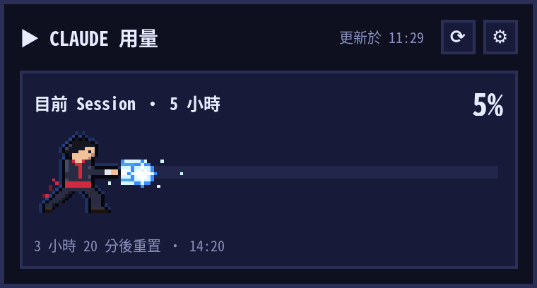
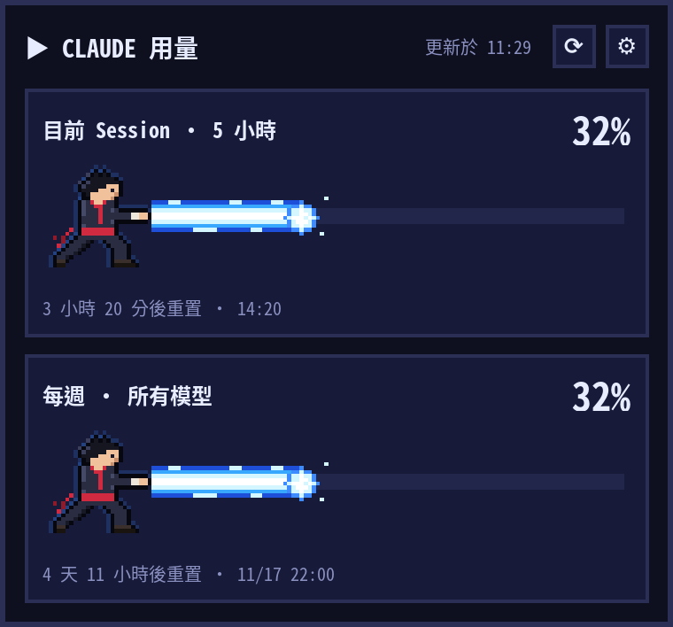
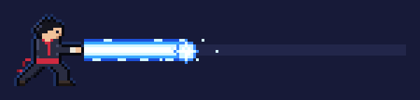

<p align="center">
  
</p>

<h1 align="center">KiMeter</h1>

<p align="center">
  適用於 Claude 的像素風 macOS 選單列用量追蹤器<br>
  一位像素武術家推出能量波，波有多長，你的額度就用了多少。
</p>

<p align="center">
  <a href="https://github.com/hchunkai821/KiMeter/releases/latest/download/KiMeter-macOS.zip"><b>⬇ 下載最新版（macOS 13 以上，Apple 晶片／Intel 通用）</b></a>
</p>

<p align="center">
  
</p>

<p align="center"><sub>Ki＝氣。KiMeter 就是你的 Claude 集氣表。</sub></p>

> [!IMPORTANT]
> **KiMeter 的唯一正式版本，只發布在作者 [@hchunkai821](https://github.com/hchunkai821) 的 GitHub：<https://github.com/hchunkai821/KiMeter>。**
> 在其他網站、雲端硬碟、社群群組、應用程式商店或其他 GitHub 帳號看到的 KiMeter，都**不是**官方版本，可能被植入惡意程式，請不要下載。
> 下載後請用 SHA-256 指紋核對檔案（見下方「官方下載與防詐騙」）。

---

## 這是什麼？

KiMeter 常駐在 macOS 右上角的選單列，隨時顯示你的 Claude 訂閱額度用了多少，不用再打開 claude.ai 的設定頁查看。

- **不耗 token、不收費**：只讀取用量數字，跟你打開 claude.ai「設定 → 用量」看到的是同一份資料，從不呼叫任何模型。
- **claude.ai 與 Claude Code 共用額度**：兩邊用掉的量都會算進來。
- **省電**：預設每 2 分鐘更新一次；動畫只在面板打開時播放，關起來就停。
- **登入資訊只存在你的 Mac 上**：不會上傳到作者或任何第三方，只會用來向 claude.ai／Anthropic 查詢你自己的用量。
- **用量通知**：用量到達你設定的門檻（預設 50%、80%）時跳出 macOS 通知。
- **聰明更新**：Mac 睡醒後自動更新；離線時安靜等待，連上網路自動補抓。
- **登入到期提醒**：claude.ai 登入剩不到 24 小時時提醒你重新登入。

### 系統需求

| 項目 | 需求 |
|---|---|
| 作業系統 | macOS 13 Ventura 以上 |
| 晶片 | Apple 晶片（M 系列）與 Intel 皆可（通用版） |
| 帳號 | Claude 訂閱帳號（Pro、Max 等有用量額度的方案） |
| 網路 | 需要連線到 claude.ai |

### 運作原理

KiMeter 會定時讀取你的帳號「用量」頁面上的數字（與 claude.ai「設定 → 用量」顯示的相同），再把它畫成能量波。整個過程：

- **只讀取數字**：不會讀取、也不會送出任何對話內容。
- **不呼叫 AI 模型**：所以不會消耗你的額度，也不會產生費用。
- **頻率可調**：預設每 2 分鐘讀一次，可在設定改成 30 秒～5 分鐘。

## 畫面

### 選單列

選單列上會顯示一條迷你像素能量條和「目前 Session」的百分比，例如 `▬▬◼ 32%`。顏色會跟著用量階段變化（藍 → 紫 → 橘）。

- 顯示 `…`：正在讀取中，或還沒登入。
- 顯示 `!`：讀取時發生問題，點開面板可看到原因。

點一下能量條就會打開詳細面板；點面板以外的地方就會收起來。

### 點開後的面板



| 區塊 | 內容 |
|---|---|
| **目前 Session · 5 小時** | 5 小時滾動額度的使用百分比，以及重置倒數和重置時間 |
| **每週 · 所有模型** | 7 天滾動額度（所有模型合計）的使用百分比，以及重置時間 |
| ⟳ 按鈕 | 立即更新 |
| ⚙ 按鈕 | 打開設定（登入方式、用量階段、通知、更新頻率、開機啟動） |

> 截圖為依照 app 實際繪圖程式產生的示意圖。

### 三個階段

能量波的長度就是使用百分比，用量越高，角色越「覺醒」。兩個階段門檻可在設定裡用拖拉把手自由調整（預設 50%、80%），同時決定能量波變色點與通知時機：

| 用量（預設） | 畫面 | 變化 |
|---|---|---|
| **0–49%** |  | 藍色能量波，角色平靜集氣 |
| **50–79%** |  | 能量波轉紫、出現衝擊波、眼睛發光、衣襟與腰帶亮起、頭髮開始飄動 |
| **80% 以上** |  | 能量波轉橘紅並變粗、雙重衝擊波、角色顫動、地面裂開碎石上飄、外框變紅 |

## 官方下載與防詐騙

**KiMeter 唯一的官方來源是這個 GitHub repo：<https://github.com/hchunkai821/KiMeter>。** 請只從這裡的 [Releases](https://github.com/hchunkai821/KiMeter/releases) 下載。

- **免費、沒有付費版**：KiMeter 不收費、沒有訂閱、沒有內購。
- **沒有任何代幣或加密貨幣**：任何以 KiMeter 名義發行的代幣、NFT、空投都是詐騙。
- **沒有官方社群帳號、客服或私訊**：作者不會主動私訊你，也不會在其他網站、群組或應用程式商店發布 KiMeter。
- **絕不會跟你要登入資訊**：任何人向你索取 sessionKey、Claude 密碼或付款，都是詐騙。KiMeter 只會把登入存在你自己的 Mac 上。
- **其他地方的版本都不是官方**：在其他網站、群組、應用程式商店或別人的 GitHub 帳號發布的 KiMeter，都不是官方版本，可能含有惡意程式。

### 核對下載檔是不是正版

**SHA-256 指紋是什麼？** 它是檔案的「身分證字號」：每個檔案都能算出一串 64 個英數字。只要檔案被改動一點點（例如被偷偷塞進惡意程式），算出來的指紋就會完全不同。每個 Release 頁面都會列出正版 `KiMeter-macOS.zip` 的指紋，你只要自己算一次、比對是否相同，就能確定拿到的是沒被動過的正版。

下載後在終端機執行：

```bash
shasum -a 256 ~/Downloads/KiMeter-macOS.zip
```

顯示的那串英數字要和 Release 頁面上的**完全一樣**；不一樣就不要開啟，直接刪除。

## 安裝

1. 點上方的 **下載最新版**，取得 `KiMeter-macOS.zip`。
2. 解壓縮，把 `KiMeter.app` 拖進「應用程式」資料夾。
3. **第一次開啟**：這個 app 沒有付費的 Apple 開發者簽章，macOS 會擋下。用以下任一方式開啟：
   - 打開「系統設定 → 隱私權與安全性」，往下捲，在 KiMeter 旁按 **強制打開**；或
   - 在終端機執行：
     ```bash
     xattr -dr com.apple.quarantine /Applications/KiMeter.app && open /Applications/KiMeter.app
     ```
4. 右上角選單列出現能量條就完成了。

## 登入（三選一）

KiMeter 需要一個登入才能讀到你的用量。三種方式讀到的是**同一份訂閱額度**，挑一種能用的就好。

### 方式一：在 KiMeter 裡登入 claude.ai（建議）

1. 點選單列的能量條，打開面板。
2. 按 **▶ 登入 claude.ai**（或點 ⚙ →「claude.ai 登入」卡片裡的 **登入 claude.ai**）。
3. 在跳出的視窗用你平常的方式登入 claude.ai。
4. 登入完成後視窗會自動關閉，用量隨即出現。

> 可以用 Google、Apple 帳號或電子郵件登入。Google 與 claude.ai 會自行決定是否允許在 app 內建視窗登入；如果出現「登入時發生錯誤」或「無法驗證您的瀏覽器」，請改用方式二或方式三。

### 方式二：貼上 sessionKey

適合方式一登入不了的人。sessionKey 是 claude.ai 的登入憑證，大約一個月會過期，到時重貼一次即可。

**先在瀏覽器登入 claude.ai，再依瀏覽器複製 sessionKey：**

**Chrome／Edge／Arc**
1. 在 claude.ai 頁面按 **⌥⌘I** 打開開發者工具。
2. 上方切到 **Application** 分頁 → 左側 **Cookies** → **https://claude.ai**。
3. 找到名稱為 `sessionKey` 的那一列，雙擊 **Value** 欄位，全選後複製。

**Safari**
1. Safari 選單 →「設定」→「進階」→ 勾選 **顯示網頁開發者功能**（只需做一次）。
2. 在 claude.ai 頁面按 **⌥⌘I** 打開網頁檢閱器。
3. 切到 **儲存空間** 分頁 → 左側 **Cookie** → **claude.ai**。
4. 找到 `sessionKey`，雙擊它的值，全選後複製。

**貼進 KiMeter**
1. 點 ⚙ → 在「claude.ai 登入」卡片展開 **登入不了？改貼 sessionKey**。
2. 貼上（開頭是 `sk-ant-sid01-`），按 **儲存**。卡片會顯示「● 已登入」。

> sessionKey 等同你的登入，請不要分享給任何人。KiMeter 只把它存在你 Mac 上的 app 內建瀏覽器裡。

### 方式三：借用 Claude Code 的登入

適合已經在用 [Claude Code](https://docs.claude.com/en/docs/claude-code/setup) 的人。KiMeter 會讀取 Claude Code 存在 macOS 鑰匙圈的登入，不需要在 KiMeter 裡另外登入。

1. 如果還沒裝 Claude Code，打開「終端機」（⌘ + 空白鍵，輸入「終端機」），貼上官方安裝指令：
   ```bash
   curl -fsSL https://claude.ai/install.sh | bash
   ```
   裝好後**開一個新的終端機視窗**，輸入 `claude --version`，有出現版本號就代表安裝成功。（其他安裝方式見[官方說明](https://code.claude.com/docs/en/setup)）
2. 在終端機執行 `claude`，輸入 `/login` 並完成登入。
3. 回到 KiMeter，點 ⚙ → 選 **Claude Code 登入** 卡片。卡片會顯示「● 已偵測到登入」（沒有的話按 **重新偵測**）。
4. 第一次讀取時 macOS 會詢問「KiMeter 想要使用鑰匙圈中的『Claude Code-credentials』」，輸入 Mac 密碼後按 **永遠允許**。

> 這條路可能較容易被伺服器限流（出現「請求太頻繁」）。如果常遇到，建議改用方式一或方式二。

## 用量通知

KiMeter 會在用量到達你設定的門檻時，跳出 macOS 通知。

**規則**
- 只有你設定的兩個門檻會通知（預設 50%、80%），中間經過的百分比不會。
- 同一個週期裡，每個門檻只通知一次；週期重置（5 小時或每週）後會重新提醒。
- 如果一次更新就同時越過兩個門檻，只會收到較高的那一則。
- 把門檻調到比目前用量還低時，下一次更新就會通知一次。
- 通知會在每次更新用量時檢查，所以最多會比實際到達晚一個更新週期（預設 2 分鐘）。

**範例**（門檻 60%、80%）

| 用量變化 | 通知 |
|---|---|
| 50% → 60% | ✅ 「已達 60%」 |
| 60% → 70% | 不通知（70% 不是門檻） |
| 70% → 80% | ✅ 「已達 80%」 |
| 80% → 95% | 不通知（都通知過了） |
| 週期重置後再到 60% | ✅ 重新通知 |

**第一次使用**：開啟通知時 macOS 會詢問是否允許 KiMeter 傳送通知，請按允許。可以在 ⚙ 按通知旁的 **測試** 確認。

## 設定項目

| 設定 | 說明 |
|---|---|
| **登入方式** | 兩張卡片，點選要使用的那一個。**claude.ai 登入**（建議）：可在 app 內登入或貼 sessionKey；**Claude Code 登入**：借用 Claude Code 的登入。選 claude.ai 但尚未登入時，會自動改用 Claude Code 的登入 |
| **用量階段** | 一條藍／紫／橘三色像素條，拖動兩個白色把手設定門檻（10%–95%，每格 5%） |
| **達到階段門檻時發送通知** | 每個週期內，每條用量到達門檻時通知一次；按 **測試** 可立刻送出一則測試通知 |
| **claude.ai 帳號** | 顯示登入狀態，可重新登入或登出 |
| **更新頻率** | 30 秒／1 分鐘／2 分鐘（預設）／5 分鐘 |
| **登入 Mac 時自動啟動** | 開機後自動出現在選單列 |

## 常見問題

**會不會消耗我的 Claude 額度或產生費用？**
不會。KiMeter 只查詢用量數字，不會送出任何對話。

**我的登入資訊安全嗎？**
claude.ai 的登入只存在 app 內建瀏覽器的 cookie 裡；Claude Code 的登入只會從 macOS 鑰匙圈讀取，不會修改，也不會寫到硬碟。兩者只會被送到 claude.ai／Anthropic 的官方網址（且只走加密連線）來查詢你的用量，不會傳給作者或任何第三方。詳見下方「安全性」與「隱私」。

**出現「請求太頻繁，伺服器暫時限流」？**
app 會自動等待後重試（從 2 分鐘開始，最多 15 分鐘），期間保留上次的數字。若持續發生，請在設定改選「claude.ai 登入」卡片。

**沒有收到用量通知？**
1. 到 ⚙ 按通知旁的 **測試**，看有沒有跳出測試通知。
2. 沒有的話，打開「系統設定 → 通知 → KiMeter」，確認 **允許通知** 已開啟。
3. 每條用量在同一個週期內，每個門檻只會通知一次；週期重置後會重新提醒。

**兩條都顯示「--%」？**
代表還沒登入，或登入已過期。照上方「登入」段落重新登入即可。

**選 Claude Code 登入，卡片顯示「已偵測到登入」但讀不到用量？**
代表 Claude Code 的登入已過期。打開終端機執行 `claude` 使用一下，它會更新登入，KiMeter 下一次更新就會自動讀到。想要更穩定，建議改用 claude.ai 登入。

**選單列上看不到 KiMeter？**
MacBook 的選單列圖示太多時，右邊的圖示會被瀏海擋住。按住 ⌘ 把其他圖示拖出選單列，或關掉一些不常用的選單列 app。

**數字跟 claude.ai 設定頁不一樣？**
按 ⟳ 立即更新。資料會有最多一個更新週期的延遲。

## 移除 KiMeter

1. 點 ⚙ → **結束 KiMeter**。
2. 把「應用程式」裡的 `KiMeter.app` 丟到垃圾桶。
3. （選擇性）完全清除設定與登入資料，在終端機執行：
   ```bash
   defaults delete com.kevin.KiMeter
   rm -rf ~/Library/WebKit/com.kevin.KiMeter ~/Library/HTTPStorages/com.kevin.KiMeter
   ```
4. 如果有開「登入 Mac 時自動啟動」，移除 app 後會自動失效。

## 安全性

**App 本身**
- **沒有伺服器、沒有後台**：KiMeter 沒有作者自己的伺服器，作者看不到、也收不到任何人的登入或用量。
- **只連官方網址**：App 只會連到 `claude.ai`（claude.ai 登入）與 `api.anthropic.com`（Claude Code 登入），而且只用 HTTPS 加密連線。
- **內建登入視窗有白名單**：整個視窗只能停在 claude.ai、Claude／Anthropic，以及 Google、Apple、Cloudflare 的登入與驗證頁面；要跳到其他網站（包括一般 http 網址）一律擋下，降低被導向釣魚網站的風險。這些官方頁面裡內嵌的登入按鈕與瀏覽器驗證只允許加密連線，不能開啟你電腦上的檔案。
- **登入資訊的保護**：貼上的 sessionKey 會先檢查格式，只接受合法字元；存進內建瀏覽器時設為「只限 HTTPS、網頁腳本讀不到」。Claude Code 的登入只暫存在記憶體，不寫入硬碟、不留快取。
- **防竄改**：App 啟用 macOS 的強化執行環境（Hardened Runtime），阻擋外部程式庫注入；程式被改動過就會無法通過簽章驗證。
- **不讀取其他資料**：不會讀取你的對話、檔案、通訊錄或其他 App 的資料，也沒有任何追蹤、廣告或統計。

**發佈流程**
- 每個版本都由 GitHub Actions 從這個 repo 的原始碼自動編譯、檢查簽章、試跑後才發佈，作者不會手動上傳檔案。
- 已發佈的版本不會被覆蓋或替換；有任何修改都會發佈新的版本號。
- 每個 Release 都附上 SHA-256 指紋，下載後請核對（見「官方下載與防詐騙」）。
- 原始碼經 SonarQube Cloud 檢驗，安全性、可靠性、可維護性皆通過。

**你可以做的事**
- 只從本頁的 Releases 下載，並核對 SHA-256。
- 不要把 sessionKey 或 Claude Code 的登入檔給任何人，也不要安裝別人「修改過」的 KiMeter。
- 保持 macOS 為最新版本，並設定 Mac 的登入密碼。
- 如果懷疑登入外洩：到 claude.ai 登出（帳號設定中可登出所有裝置），sessionKey 就會立刻失效；再到 KiMeter 的設定按 **登出並清除**。

**限制**：沒有任何軟體能保證百分之百安全。KiMeter 沒有付費的 Apple 開發者簽章與公證，所以第一次開啟需要手動允許（見「安裝」），這也是為什麼請你一定要核對 SHA-256。

## 隱私

- KiMeter 只讀取用量數字（百分比與重置時間），不會讀取或傳送你的對話內容。
- 登入資訊只存在你的 Mac 上，只會被送到 claude.ai／Anthropic 用來查詢你自己的用量，不會傳給作者或任何第三方。
- App 本身只連線到 `claude.ai` 與 `api.anthropic.com`，沒有任何追蹤、廣告或統計。
- 使用內建登入視窗時，你看到的是 claude.ai 的官方網頁；若選擇用 Google 或 Apple 帳號登入，會開啟 Google／Apple 的登入頁。這些網頁的資料處理方式由各自的網站負責，與你在一般瀏覽器登入相同。
- 選擇 Claude Code 登入時，只會**讀取** Claude Code 存在鑰匙圈的登入，不會修改它。
- 設定（門檻、更新頻率等）只存在你 Mac 的 App 設定檔裡，移除方式見「移除 KiMeter」。

## 免責聲明

使用 KiMeter 前，請先閱讀以下說明。下載、安裝或使用本軟體，即表示你已了解並同意這些內容。

1. **非官方軟體**：KiMeter 是個人開發的非官方工具，與 Anthropic PBC 沒有任何關聯，也未獲其認可、贊助或支持。「Claude」「Claude Code」「Anthropic」等名稱與商標屬於其各自的權利人，本專案僅為說明用途而提及。
2. **依現狀提供**：本軟體依「現狀」提供，不附帶任何明示或默示的保證，包括但不限於適售性、特定用途適用性、正確性及不侵權等保證。
3. **資料可能不準確或中斷**：用量資料取自 claude.ai 網頁使用的非公開介面，並非 Anthropic 提供的正式 API。顯示的數字可能有延遲或誤差，也可能因 Anthropic 調整介面而無法使用。請以 claude.ai 官方頁面顯示的用量為準，不要只依賴本軟體做重要決策。
4. **帳號與服務條款**：你需自行確認使用本軟體符合 Anthropic 的服務條款與使用政策，並自行承擔使用風險。作者不對任何帳號限制、停權、資料遺失或其他後果負責。
5. **登入資訊由你自行保管**：sessionKey 與 Claude Code 的登入等同你的帳號憑證，只會存在你的 Mac 上。請勿分享給他人，並請妥善保管你的電腦。因登入資訊外洩造成的損失，作者不負任何責任。
6. **責任限制**：在法律允許的最大範圍內，作者對因使用或無法使用本軟體所產生的任何直接、間接、附帶、特殊或衍生性損害，均不負賠償責任。
7. **非官方來源與修改版本**：只有從 https://github.com/hchunkai821/KiMeter 的 Releases 下載、且 SHA-256 相符的檔案才是作者發佈的版本。從其他來源取得、或被他人修改過的版本，與作者無關，作者不負任何責任。
8. **安全性**：作者已盡力降低風險（見「安全性」），但不保證本軟體沒有錯誤或漏洞，也不保證能抵禦所有攻擊。使用者應自行評估風險並保護好自己的裝置與帳號。
9. **條款變更**：本聲明可能隨版本更新而修改，以 GitHub 上最新版本的 README 為準。

## 更新紀錄

### KM v1.0.0 — 2026-11-15

第一個正式版本。

- 像素風選單列用量追蹤：顯示「目前 Session · 5 小時」與「每週 · 所有模型」兩條用量及重置倒數
- 能量波動畫：用量越高，能量波顏色與角色狀態跟著變化（三個階段）
- 自訂用量階段：拖動把手設定兩個門檻（預設 50%、80%），同時決定變色點與通知時機
- 用量通知：到達門檻時通知，每個週期每個門檻各一次；可送出測試通知
- 三種登入方式：在 app 內登入 claude.ai、貼上 sessionKey、借用 Claude Code 的登入
- Mac 睡眠喚醒後自動更新、離線時安靜等待並在連線後補抓
- claude.ai 登入快到期時提醒
- 被伺服器限流時自動延後重試
- 開機自動啟動、可調整更新頻率
- 官方下載說明與防詐騙提醒，每個 Release 附上 SHA-256 指紋供核對
- 安全性：sessionKey 格式檢查並以「只限 HTTPS、網頁腳本讀不到」的方式保存；Claude Code 登入的查詢不存 cookie、不留快取、只用 TLS 1.2 以上的加密連線；啟用 macOS 強化執行環境（Hardened Runtime）防止竄改
- 發佈流程：由 GitHub Actions 從原始碼自動編譯、驗證簽章並試跑後才發佈；第三方元件固定版本、最小權限；已發佈的版本不可覆蓋或修改
